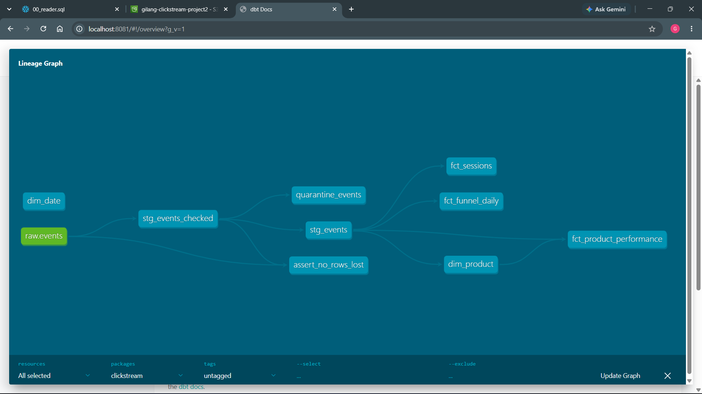
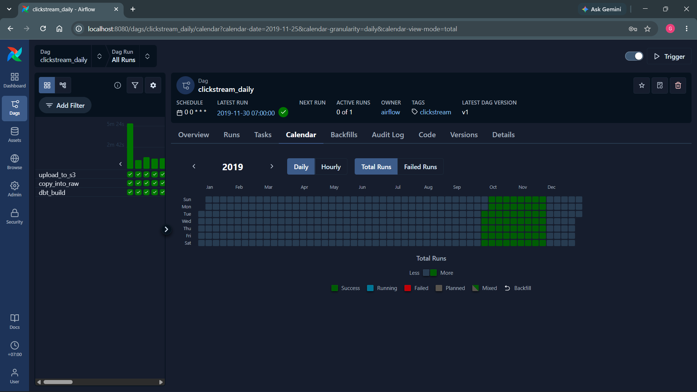
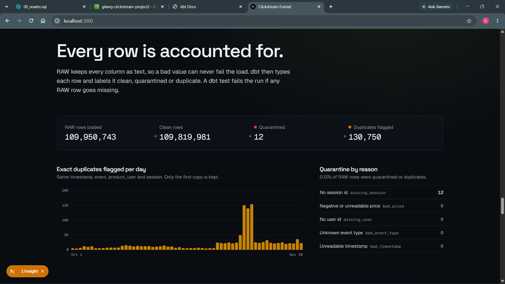

# E-commerce Clickstream Pipeline

Idempotent daily ELT for 110M e-commerce events on **AWS S3, Snowflake, dbt and Airflow 3**, with a Snowpipe add-on for near-real-time loading.

[](https://github.com/MaulanaGilang/ecommerce_clickstream_snowflake/actions/workflows/ci.yml)

**Live dashboard:** [gilangmaulana-blue.vercel.app/projects/ecommerce-clickstream/dashboard](https://gilangmaulana-blue.vercel.app/projects/ecommerce-clickstream/dashboard)

**The question:** where do shoppers drop off between viewing, adding to cart and buying, and which categories, brands and price ranges convert best?

**The answer, in one line:** only 10.1% of the 23M sessions ever add anything to the cart, but 61% of the sessions that do go on to buy. The leak is before the cart, not in it.

## Results

| Metric | Value |
| --- | --- |
| Events loaded | 109,950,743 (42,448,764 Oct + 67,501,979 Nov), none rejected |
| Row reconciliation | 109,819,981 clean + 12 quarantined + 130,750 duplicates = 109,950,743 RAW |
| Rows quarantined, by reason | 12 (`missing_session`: 12; all other reasons 0) |
| Exact duplicates flagged | 130,750 (0.12%) |
| dbt models / tests | 8 models, 15 tests, all passing on every run |
| 61-day backfill | 1 h 25 min of run time, 1 retry (Oct 10, after a local Docker restart) |
| Snowflake credits used | 2.67 of a 40-credit cap |
| Snowpipe median latency | 11 s (185 files, Nov 30 replayed one file per minute) |

## Architecture


<details>
<summary>Text version</summary>

```
CSV (14.7 GB) ─split─▶ S3 landing/ (61 daily Parquet folders, 2.7 GB)
                          │  Airflow 3, one run per day:
                          ├─ upload_to_s3 ─▶ copy_into_raw ─▶ dbt_build
                          ▼
              Snowflake RAW.EVENTS (all text) ─▶ dbt staging ─▶ dbt marts
                                                  (typed, flagged)   (sessions, funnel, products)
                                                                       │
                                               dashboard/export.py ◀───┘ ─▶ website (static)

Add-on: S3 live/ ─(event notification)─▶ Snowpipe ─▶ RAW.EVENTS_LIVE
```

</details>

### dbt lineage



### 61 daily runs, all green



### Every row accounted for



### Snowpipe, live

[Watch the clip](docs/live_clip.mp4): files dropped into `s3://…/live/` once a minute, with rows appearing in `RAW.EVENTS_LIVE` about 11 seconds later.

## How it works

**Daily partition contract.** The two monthly CSVs are split once into one Parquet folder per day (`landing/event_date=YYYY-MM-DD/`). Every Airflow run handles exactly one day, like a shop sending a new file each night. Airflow's catchup replays all 61 days in order (`max_active_runs=1`).

**Idempotency at every step.** Upload overwrites the same S3 keys. `COPY INTO` skips files Snowflake has already loaded (64-day load history). dbt models use `delete+insert` or `merge` keyed on the day or session. Any task can be retried, or a whole day cleared and rerun, without creating duplicates. This was tested for real: the Oct 10 run was interrupted mid-flight, retried, and the final row counts still match the source CSVs exactly.

**Quarantine, not deletion.** RAW keeps every column as text, so a bad value can never fail the load. `stg_events_checked` types each row with `try_to_*`, then labels it with a `reject_reason` or `is_duplicate`. Clean rows flow on; the rest are counted in `quarantine_events`. A singular test (`assert_no_rows_lost`) fails the run if any RAW row is missing. Zero prices are kept as valid (the source has free items); only negative or unreadable prices are rejected.

**Sessions that cross midnight.** `fct_sessions` finds sessions touched on the run date and rebuilds them from *all* their events before merging, so a session from 23:50 to 00:10 is updated, not split or half-counted.

**Least privilege.** Airflow and dbt connect as `PIPELINE_SVC`, a key-pair service user with the `TRANSFORMER` role. It can read RAW and build the analytics schemas, nothing else. The uploader IAM user can only write to `landing/` and `live/`.

## Problems I hit, and what I changed

**AWS blocked Snowflake's IAM role.** The usual setup is a storage integration: Snowflake assumes an IAM role in your account. On the AWS free plan, the account sits in an AWS-managed organization that blocks outside accounts from assuming roles, so every `LIST` failed with `not authorized to perform sts:AssumeRole`, even with a correct trust policy. The stages now use a dedicated IAM user, `snowflake-reader`, that can only list and read `landing/` and `live/`. Its key is typed into Snowsight and never stored in this repo. ([02_s3_integration.sql](snowflake/02_s3_integration.sql) keeps both versions.)

**The laptop ran out of memory.** The official Airflow compose file runs 8 containers (Celery worker, Redis, triggerer and more). On an 8 GB laptop, Docker's VM hit its memory ceiling and froze mid-backfill. I switched to the `LocalExecutor` with a parallelism of 2, which runs the same DAG on 4 containers. Because every task is idempotent, the interrupted run simply retried.

## Data profile

| | Oct 2019 | Nov 2019 |
| --- | --- | --- |
| Rows | 42,448,764 | 67,501,979 |
| Views / carts / purchases (%) | 96.07 / 2.18 / 1.75 | 94.15 / 4.49 / 1.36 |
| Null `category_code` | 31.8% | 32.4% |
| Null `brand` | 14.4% | 13.7% |
| Exact duplicates | 30,220 | 100,530 |

Full profile: [docs/data_profile.md](docs/data_profile.md)

## Repository layout

```
ingestion/        split CSVs into daily Parquet, upload a day to S3, Snowpipe replayer, local live page
snowflake/        one-time setup SQL: warehouse + budget, S3 stage, RAW table + service user, Snowpipe
airflow/          Docker Compose (LocalExecutor), Dockerfile, the clickstream_daily DAG
dbt_project/      staging (typing, quarantine, dedupe) and marts (sessions, funnel, products, dates)
dashboard/        export.py (Snowflake + Airflow -> JSON) and the static Next.js site
tests/            pytest for the split, the upload and the DAG structure
docs/             screenshots, the clip, and the data profile
```

## Run it yourself

Prerequisites: Python 3.12, Docker Desktop (8 GB RAM is enough), AWS CLI, an AWS account, and a Snowflake trial on **AWS in the same region as your bucket** (here `ap-southeast-2`).

```powershell
# 0. environment (Windows; use `source .venv/bin/activate` on macOS/Linux)
python -m venv .venv
.venv\Scripts\activate
pip install -r requirements.txt

# 1. data: download the two CSVs, then split them into daily Parquet folders
kaggle datasets download -d mkechinov/ecommerce-behavior-data-from-multi-category-store -p data/raw --unzip
python ingestion/split_daily.py

# 2. Snowflake: run snowflake/01_setup.sql, 02_s3_integration.sql and 03_raw.sql in Snowsight
#    (03_raw.sql needs the body of your rsa_key.pub pasted in)

# 3. Airflow: copy the env template, fill it in, then start
cd airflow
copy .env.example .env
docker compose up airflow-init
docker compose up -d          # UI at http://localhost:8080, then unpause clickstream_daily

# 4. dashboard data, after the backfill (from the repo root, with Airflow's postgres running)
python dashboard/export.py --credits <credits used>
```

To run dbt by hand: `cd dbt_project/clickstream`, set `SNOWFLAKE_ACCOUNT` and `SNOWFLAKE_PRIVATE_KEY_PATH`, then `python -m dbt.cli.main build --profiles-dir . --vars '{"run_date": "2019-10-01"}'`.

## Cost controls

| Item | Guardrail |
| --- | --- |
| Snowflake warehouse | XS, `AUTO_SUSPEND = 60`, resource monitor suspends at 40 credits (2.67 used) |
| Snowpipe | Paused and S3 notification removed after the demo |
| S3 | Zero-spend budget alert; 2.7 GB costs cents per month |
| Airflow | Local Docker, $0 (managed MWAA would be ~$358/month) |
| Dashboard | Static site reading exported JSON; never queries Snowflake |

## What I'd do next

- Terraform for the AWS and Snowflake setup
- A CI job that runs `dbt build` against a dev schema
- dbt snapshots for product price history
- Deploy the DAG to MWAA unchanged; there, a storage integration would replace the reader key

## Data and licence

REES46 eCommerce behaviour data (multi-category store), via [Kaggle](https://www.kaggle.com/datasets/mkechinov/ecommerce-behavior-data-from-multi-category-store). Used for education with attribution to the REES46 Marketing Platform.
